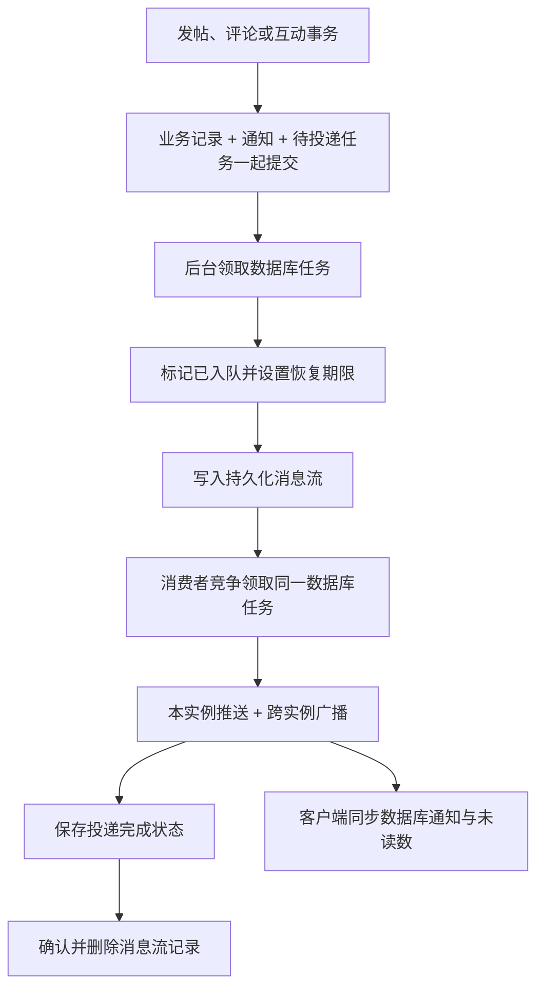

# 可靠异步通知

本次改动把回复、点赞、关注、提及和精华通知的实时投递移到持久化后台任务。通知仍在原业务事务中生成，客户端通过通知列表查询得到最终业务状态。

## 可靠性目标

- 业务数据、站内通知和待投递任务在同一个数据库事务中提交或回滚。
- 进程退出后，未投递任务和超时领取任务能够继续处理。
- 多实例通过数据库原子条件更新竞争任务，领取凭据防止旧负责人覆盖新状态。
- 消息允许至少一次处理。重复投递复用同一个通知编号，不创建第二条站内通知；前端按编号合并，未读数以数据库查询为准。
- 在线推送是及时提醒。推送完成不表示浏览器已接收，更不表示用户已读。断线、订阅短暂中断及离线使用通过重连、定期同步和历史分页补偿。
- 自动重试有上限；耗尽后保留失败任务，管理员检查并重放。普通用户不能访问运维接口。

## 调用链



代码入口：

| 文件 | 职责 |
|---|---|
| [NotificationService](../src/main/java/cn/tbforum/notif/NotificationService.java) | 事务内创建通知与任务；投递时重用通知并读取当前用户及已读状态；保留账号安全断连链路 |
| [NotificationTaskStore](../src/main/java/cn/tbforum/notif/NotificationTaskStore.java) | 短事务原子领取、领取凭据校验、超时恢复、退避、失败重放及成功任务保留期清理 |
| [NotificationStream](../src/main/java/cn/tbforum/notif/NotificationStream.java) | 持久化流、消费者组、未确认消息接管、原子确认与删除 |
| [NotificationWorker](../src/main/java/cn/tbforum/notif/NotificationWorker.java) | 独立后台线程执行入队、消费、指标采样与任务清理 |
| [NotificationController](../src/main/java/cn/tbforum/controller/NotificationController.java) | 通知历史分页、数据库未读数和已读操作 |
| [NotificationTaskController](../src/main/java/cn/tbforum/controller/NotificationTaskController.java) | 管理员失败任务查询及重放 |
| [NotificationContext](../frontend/src/contexts/NotificationContext.tsx) | 重连、每三十秒同步、窗口恢复同步、请求身份隔离、历史合并与分页 |
| [迁移文件](../src/main/resources/db/migration/V8__reliable_notifications.sql) | 新任务表、唯一通知关联及查询索引 |
| [评论计数校正迁移](../src/main/resources/db/migration/V9__reconcile_comment_counts.sql) | 将历史错误计数校正为未软删评论数，只更新不一致帖子 |

消息流默认键为 `tbforum:notifications:delivery`，消费者组为 `notification-dispatch`。流中只保存任务编号，不保存认证令牌或通知正文。一个消费者组分配后台投递工作，原有跨实例广播负责到达各实例持有的连接。

## 状态和故障窗口

| 状态 | 含义与后续行为 |
|---|---|
| `READY` | 等待首次处理或到期重试 |
| `IN_FLIGHT` | 已领取，持有随机领取凭据和租约；到期后其他实例可以接管 |
| `QUEUED` | 已准备入队或已写入消息流；消费者可领取，超过队列等待期限也可从数据库重建投递 |
| `SENT` | 本次投递已执行，跨实例发布命令成功；不表示客户端确认接收或已读 |
| `DEAD` | 自动尝试耗尽，等待管理员处理 |

先把任务标记为 `QUEUED`，再写消息流，避免消费者读到消息时数据库仍处于发布者领取状态。标记后、入队前退出的窗口，由队列等待期限恢复；入队命令成功但响应丢失可能产生重复记录，由任务状态和通知身份处理重复。

投递后、保存 `SENT` 前退出，可能再次推送同一通知。系统接受这种重复，不承诺端到端恰好一次。数据库中始终只有原通知，前端去重且不会根据推送次数累计未读数。

后台消费失败时，先把重试安排持久化到数据库，再确认旧流记录；进程在两者之间退出时，未确认记录仍可由其他消费者接管。即使消息流数据被意外清空，未完成数据库任务也能在队列期限后重新入队；已耗尽的任务需要管理员重放。

领取使用 `FOR UPDATE SKIP LOCKED` 在短事务内跳过被占用的记录，再执行条件更新；完成和失败更新也检查当前状态和随机领取凭据。网络操作期间不持有数据库行锁。当前实现依赖实例时钟基本同步；生产部署应保持正常的系统时间同步，并结合网络超时设置租约。

账号封禁、注销、密码重置导致的连接断开仍走原安全链路，不放入普通通知任务，也不修改其鉴权规则。

## 配置与运行

生产配置启用 Redis 后使用持久化消息流；开发关闭 Redis 时仍保留数据库异步任务，在单实例内推送。关闭 Redis 的模式不提供跨实例实时广播，客户端仍可查询通知。

| 环境变量 | 默认值 | 含义 |
|---|---|---|
| `NOTIFICATION_WORKERS_ENABLED` | `true` | 是否运行后台投递；关闭时业务仍提交通知及任务 |
| `NOTIFICATION_CONSUMER_ENABLED` | `true` | 是否消费消息流；可用于隔离诊断，不应长期关闭所有消费者 |
| `NOTIFICATION_STREAM_KEY` | `tbforum:notifications:delivery` | 专用流键；同组实例必须相同，不同环境应使用独立缓存或不同键 |
| `NOTIFICATION_POLL_INTERVAL` | `500ms` | 后台轮询间隔 |
| `NOTIFICATION_LEASE` | `30s` | 领取租约及未确认流记录的最小接管等待时间 |
| `NOTIFICATION_QUEUE_TIMEOUT` | `60s` | 已入队任务未完成时的数据库恢复期限，不得小于租约 |
| `NOTIFICATION_RETRY_BASE` | `2s` | 指数退避初始时间 |
| `NOTIFICATION_RETRY_MAX` | `5m` | 单次退避上限 |
| `NOTIFICATION_MAX_ATTEMPTS` | `8` | 一轮自动投递最多尝试次数；进程中断恢复也计入次数 |
| `NOTIFICATION_COMPLETED_RETENTION` | `14d` | 成功投递任务保留期，仅清理成功任务记录，不删除通知或失败任务 |

任务默认每批五十条，成功记录每分钟按批清理。失败任务保留供检查，不自动丢弃。持续大量故障时应监控积压和数据库容量；重试次数上限不能替代运维处理。

容器配置已为 Redis 启用持久化并挂载数据卷。独立部署 Redis 时也应启用合适的持久化、内存与淘汰策略，并让生产实例使用正确的连接凭据。数据库任务提供恢复依据，仍需要正常备份数据库。

迁移新增任务表和通知历史索引，不为历史通知批量创建投递任务。已存在通知继续可查；这样可以避免升级时重发所有历史提醒。新增通知走新链路。

### 验证中追加修复的评论计数

双实例验证发现旧实现的评论实际行数为七十六，帖子计数却为五十一。原因是数据库原子增加后，又把之前读到的帖子计数加一并交给实体刷新，覆盖了并发事务已经写入的值。

本次移除创建和删除路径中的重复实体计数写入，将 `Post.commentCount` 设为不参与实体更新的字段，只允许专门的数据库原子语句更新；这样其他事务持有旧帖子后修改标题，也不能把评论计数覆盖回旧值。删除使用条件软删除，只有首次实际删除才扣减计数、关闭举报和记录审计；软删除标记也不参与普通实体更新，防止旧评论编辑把已删除记录恢复为未删除，破坏计数。

历史校正迁移按所有未软删除评论统计（包含回复），只修正不一致的帖子计数，不修改评论、通知或其他帖子字段。生产升级应先停止旧版本写入，再在合适的变更窗口执行迁移，避免旧逻辑继续覆盖计数。开发文件库默认未启用迁移，不会自动校正历史计数；本次没有启动或修改原业务数据库，校正语句在独立验证库执行。

## 查询与重放

用户查询：

```text
GET /api/notifications/history?size=50
GET /api/notifications/history?size=50&before=<nextBefore>
```

返回 `content`、`unreadCount`、`nextBefore`、`hasMore`。每页一至一百条，按通知编号倒序。每次同步重新读取最新窗口，可发现窗口内晚提交的记录，避免仅使用递增编号水位；窗口外通知通过历史分页访问。这里提供可查询的通知历史，不承诺无限消息量下的逐条增量交付。分页与未读数在同一个可重复读事务中读取，只返回当前用户通知。旧 `/api/notifications` 接口保留兼容。

管理员操作（沿用登录认证与管理员权限）：

```text
GET /api/admin/notification-tasks?status=DEAD&page=0
POST /api/admin/notification-tasks/<id>/replay
```

仅 `DEAD` 可以重放；成功后恢复待处理并重置自动尝试次数。不创建新通知。重复重放同一个已恢复任务返回 `409`；普通用户返回 `403`。查询仅返回任务编号、关联通知编号、状态、次数、时间和异常类别，不暴露领取凭据、认证令牌、正文或连接凭据。

## 指标

- `tbforum.notifications.tasks`：按 `status` 区分待处理、已入队、处理中和失败任务数。
- `tbforum.notifications.oldest.seconds`：最老未完成任务的等待秒数。
- `tbforum.notifications.events`：领取、重试、入队、发布失败、投递失败、投递完成、重复或过期记录、后台异常等事件计数。
- 原连接数和跨实例广播指标继续保留。任务数量与最老等待时间每五秒采样，不能当作实时事务快照。

## 验证方式

自动检查：

```powershell
mvn '-Dmaven.repo.local=work/m2' verify
cd frontend
npm run build:deploy
node --test tests/notifications.test.mjs
```

前端合并用例需要支持直接加载 `.ts` 文件的 Node.js，本次验证版本为 `24.16.0`。

真实进程与双实例验证使用 [verify-notifications.py](../scripts/verify-notifications.py)。脚本需要 Windows 本机 PostgreSQL 程序和 Ubuntu 子系统中的 `redis-server`，以及独立验证用 Python 环境中的 `psycopg[binary]`、`redis`、`websocket-client`、`psutil`。现有验证环境可运行：

```powershell
& work/loadtest-20261015/venv/Scripts/python.exe -u scripts/verify-notifications.py --run-id <unique-run-id>
```

脚本新建专用数据库集群、缓存目录、上传目录和配置；固定使用 `35432`、`36379`、`38089`、`38090`，端口已占用时拒绝开始。支持 `--postgres-bin` 指定本机数据库程序位置。原始运行输出位于被忽略的 `outputs/notification-<run-id>/`，配置及隔离数据位于被忽略的 `work/notification-<run-id>/`。配置含验证凭据，不应提交。

脚本覆盖：提交后投递前结束进程、双实例竞争与双方连接接收、重复消息、缓存服务不可用时的有限重试与管理员重放、持久化流重启与未确认消息接管、推送后完成前结束进程、超过二十条的离线历史补拉、重复已读、权限和指标。推送后结束进程的时序通过专用验证库中的临时触发器暂停完成更新，再强制结束应用，并中止该暂停会话以确保完成事务回滚，恢复后删除触发器；生产代码没有故障注入入口。单纯关闭客户端连接不能保证数据库已经执行的语句回滚，因此不能把这一假设当作验证前提。

## 2026-10-18 实测结果

最终运行包记录位于 `outputs/notification-20261018-release/`，包含运行包副本、指纹、应用与数据库日志、`results.json`、`browser-verification.json` 及界面截图。已测试源码与构建指纹汇总为 `outputs/notification-tested-manifest.json`。这些原始材料保存在本机，不提交验证凭据与运行数据。

| 验证 | 实测结果 |
|---|---|
| 后端全量测试 | 一百五十二项通过，失败、错误、跳过均为零；最终构建和格式检查通过 |
| 前端 | 构建及部署产物同步通过；两项合并、去重与历史保留用例通过 |
| 提交后投递前退出 | 已提交评论和通知保留，重启后任务完成 |
| 双实例并发与广播 | 三十二个并发评论产生三十二条独立通知，两个实例上的连接各收到全部三十二条；帖子计数与实际评论数均为三十三 |
| 双实例重复删除 | 十六个并发删除请求只实际删除一次，计数和实际未删除评论数均为三十二，仅一条删除审计 |
| 重复队列记录 | 注入十条已完成任务的重复记录，新增通知和额外实时推送均为零 |
| 缓存服务停机与重放 | 业务提交成功，四次尝试后进入失败状态；恢复服务后管理员重放成功，普通用户操作被拒绝 |
| 消息流持久化与接管 | 应用和缓存服务重启后，未确认记录由其他消费者接管，最终未确认数为零 |
| 投递后、完成提交前退出 | 中止应用与专用暂停会话后，另一个实例恢复任务，第二次尝试完成；通知身份保持不变 |
| 离线历史与已读 | 七十六条通知完整分页查询、无重复；同一通知重复标记已读后，未读数只减少一次 |
| 历史错误计数校正 | 模拟错误计数从零恢复为七十五，与实际未删除评论数一致；其他帖子字段不变 |
| 浏览器检查 | 通知从五十条继续加载到七十六条；全部已读后数据库未读数为零；页面评论数显示七十五 |

真实数据库验证使用本机 PostgreSQL，而非内存兼容模式；具体版本保存在 `browser-verification.json`。本轮验证范围是故障恢复与并发正确性，没有重新测定吞吐上限。成功任务不等于客户端确认接收，自动重试耗尽后仍需要运维处理；这些边界没有因测试通过而消失。
